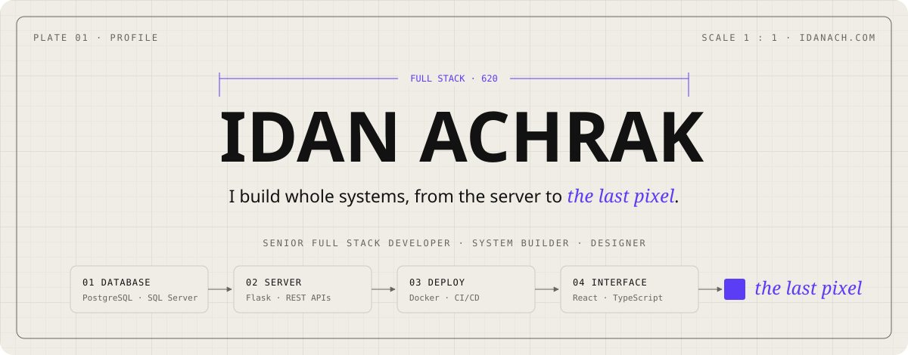
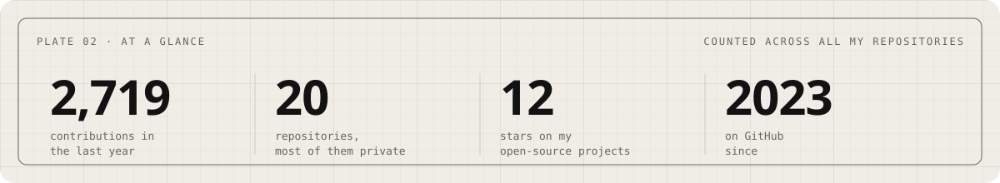
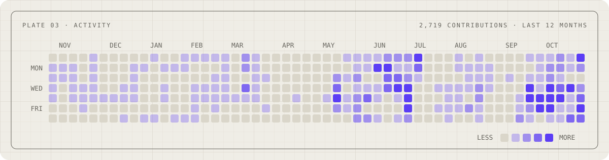
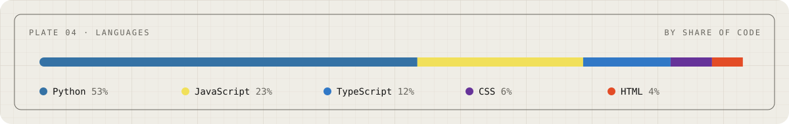
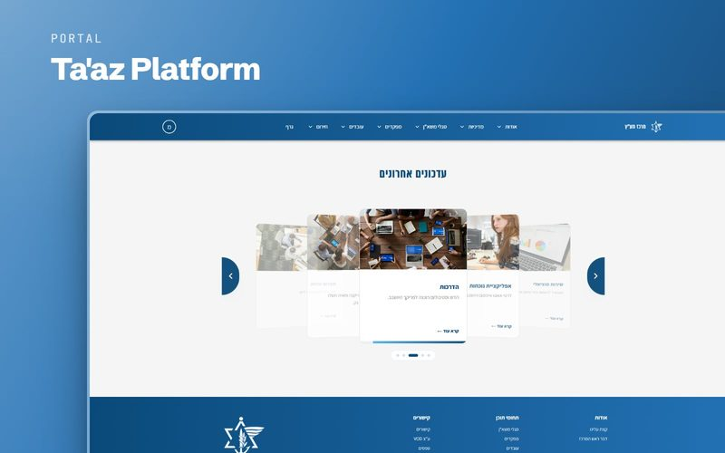
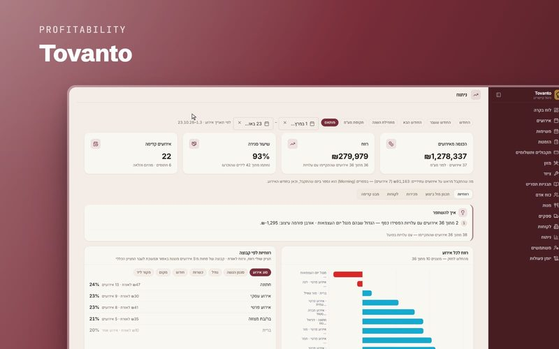
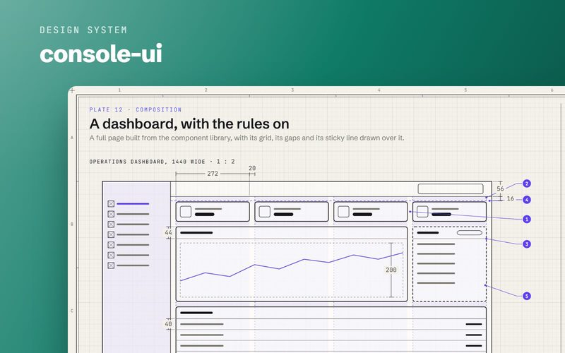
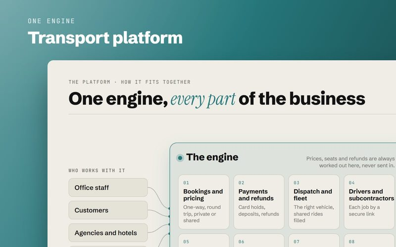
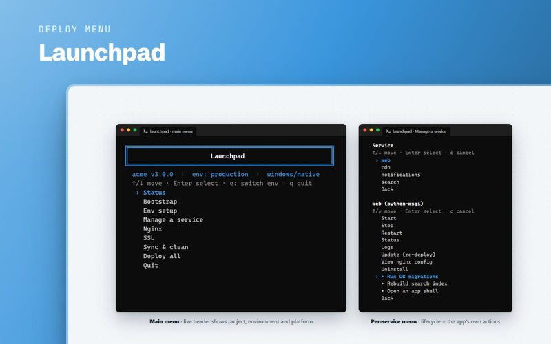
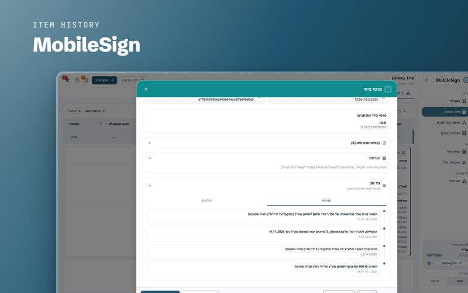

<picture>
  <source media="(prefers-color-scheme: dark)" srcset="assets/banner-dark.svg">
  
</picture>

Senior full-stack developer and DevOps engineer at Merkaz Ta'az (IDF), where I lead two teams. I build whole systems and design them, from the server to the last pixel: web platforms, deployment tools, monitoring and event apps, and the interfaces people use every day.

**[idanach.com](https://idanach.com)** &nbsp;·&nbsp; [LinkedIn](https://www.linkedin.com/in/idanach)

<picture>
  <source media="(prefers-color-scheme: dark)" srcset="assets/plate-glance-dark.svg">
  
</picture>

<picture>
  <source media="(prefers-color-scheme: dark)" srcset="assets/plate-activity-dark.svg">
  
</picture>

<picture>
  <source media="(prefers-color-scheme: dark)" srcset="assets/plate-languages-dark.svg">
  
</picture>

### Selected work

<table>
<tr>
<td width="33%" valign="top"> One self-service place, in Hebrew, for Ta'az's official information, and the platform that runs it.</td>
<td width="33%" valign="top"> Work on your catering business, not in it.</td>
<td width="33%" valign="top"> One design system, a shared component library, for every admin screen I build.</td>
</tr>
<tr>
<td width="33%" valign="top"> One engine that runs a whole transport business.</td>
<td width="33%" valign="top"> One settings file, and Launchpad sets up the server, deploys the apps and keeps watch, even on a network with no internet connection.</td>
<td width="33%" valign="top"> Signing for equipment on screen instead of on paper, with a record of every hand-over that no one can change.</td>
</tr>
</table>

### Open source

- **[Wicogen](https://github.com/idanach/Wicogen-windows-icon-generator)**: pick a picture, or let it find one online, and Wicogen turns it into a Windows folder icon.
- **[Launchpad, first generation](https://github.com/idanach/nginx-server-deployment)**: where Launchpad began, open under the MIT licence.

